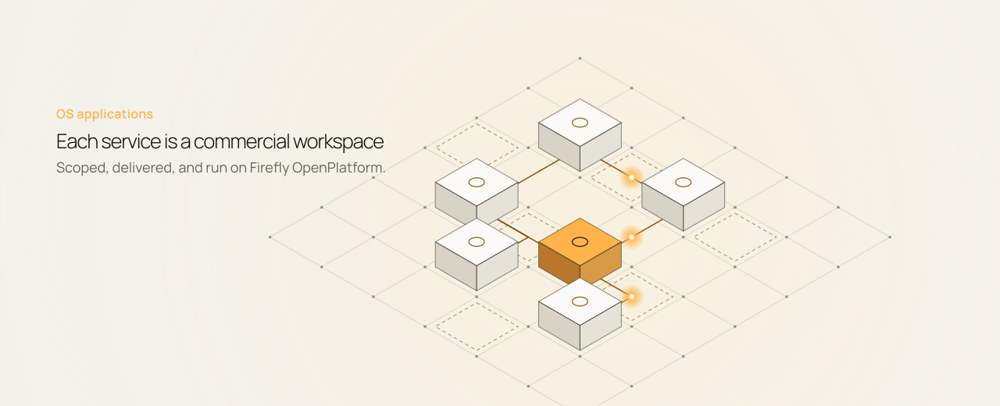
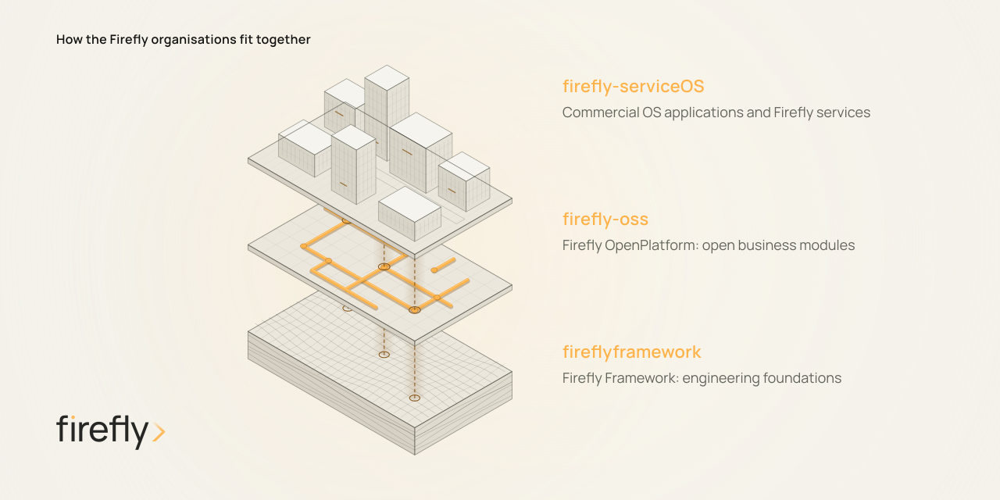

<a href="https://fireflysoftware.io/services/">
<picture>
  <source media="(prefers-color-scheme: dark)" srcset="assets/banner.png">
  
</picture>
</a>

# Firefly services

This organisation holds the commercial **OS applications** behind [Firefly services](https://fireflysoftware.io/services/): defined banking and insurance operations that institutions scope and purchase with Firefly Software.

Each service has agreed inputs, acceptance criteria, and a clear owner for exceptions. Your institution keeps its policies and regulated decision authority. AI works within approved limits; people with delegated authority handle significant or out-of-limit decisions.

These repositories are the commercial layer. They are not the open Firefly OpenPlatform modules. Those live in [`firefly-oss`](https://github.com/firefly-oss). Engineering frameworks live in [`fireflyframework`](https://github.com/fireflyframework).

[Services](https://fireflysoftware.io/services/) · [OpenPlatform](https://fireflysoftware.io/openplatform/) · [Ecosystem](https://fireflysoftware.io/ecosystem/) · [Book an operations review](https://fireflysoftware.io/contact/)

## What you buy here

Firefly services are commercial engagements: an operation to run, a unit of work you can accept, and the OS application workspace that supports it. Delivery, client configuration, and intellectual property sit in the agreement. Open-source repositories keep their own licenses.

<picture>
  <source media="(prefers-color-scheme: dark)" srcset="assets/services-dark.png">
  
</picture>

## Banking and lending

### [CreditOS](https://fireflysoftware.io/services/creditos/) · Credit Operations

From loan application to a complete credit file. Unit of work: an accepted credit file.

### [ServicingOS](https://fireflysoftware.io/services/servicingos/) · Loan Servicing Operations

Daily servicing after funding. Unit of work: an active loan account, serviced for the month.

### [CollectionsOS](https://fireflysoftware.io/services/collectionsos/) · Arrears and Collections Operations

Accounts in arrears under your treatment rules. Unit of work: an account under management.

## Insurance

### [UnderwritingOS](https://fireflysoftware.io/services/underwritingos/) · Insurance Underwriting Operations

Broker submissions, cleared before underwriting. Unit of work: a complete submission, ready for your underwriter.

### [PolicyOS](https://fireflysoftware.io/services/policyos/) · Policy Operations

Issuance, endorsements, renewals, and cancellations. Unit of work: a completed policy transaction.

### [ClaimsOS](https://fireflysoftware.io/services/claimsos/) · Claims Operations

Claims stages worked on a complete, documented file. Unit of work: a completed claims stage.

## Shared operations

### [OnboardingOS](https://fireflysoftware.io/services/onboardingos/) · Customer and Business Onboarding

Onboarding and refresh cases ready for review. Unit of work: a completed onboarding or refresh case.

### [ReconcileOS](https://fireflysoftware.io/services/reconcileos/) · Reconciliation Operations

Reconciliations closed at every cutoff. Unit of work: a closed reconciliation cycle.

### [FinancialCrimeOS](https://fireflysoftware.io/services/financialcrimeos/) · Financial Crime Operations

Alerts and reviews written up for the compliance team. Unit of work: an accepted investigation.

### [RiskOS](https://fireflysoftware.io/services/riskos/) · Risk and Actuarial Operations

Close and model cycles with checkable evidence. Unit of work: a completed close or model cycle.

## How the ecosystem fits

Firefly Software sells and delivers the services. This organisation hosts the commercial OS applications. [`firefly-oss`](https://github.com/firefly-oss) publishes the reusable OpenPlatform business modules those applications build on. [`fireflyframework`](https://github.com/fireflyframework) holds the engineering foundations underneath.

<picture>
  <source media="(prefers-color-scheme: dark)" srcset="assets/ecosystem-dark.png">
  
</picture>

- [Company](https://fireflysoftware.io/company/) · Firefly Software
- [Services](https://fireflysoftware.io/services/) · what customers buy
- [OpenPlatform](https://fireflysoftware.io/openplatform/) · open business modules in [`firefly-oss`](https://github.com/firefly-oss)
- [Frameworks](https://fireflysoftware.io/technology/frameworks/) · engineering foundations in [`fireflyframework`](https://github.com/fireflyframework)

## Start with one operation

For an operational engagement, begin with an [operations review](https://fireflysoftware.io/contact/). We map the work, agree a Service Blueprint, deploy against acceptance criteria, and then run the service.

  <a href="https://fireflysoftware.io/services/">Explore Firefly services</a>
  · <a href="https://fireflysoftware.io/contact/">Book an operations review</a>

Attitude makes the difference. The Firefly name and visual identity belong to Firefly Software Solutions Inc. Each repository defines its own license.
